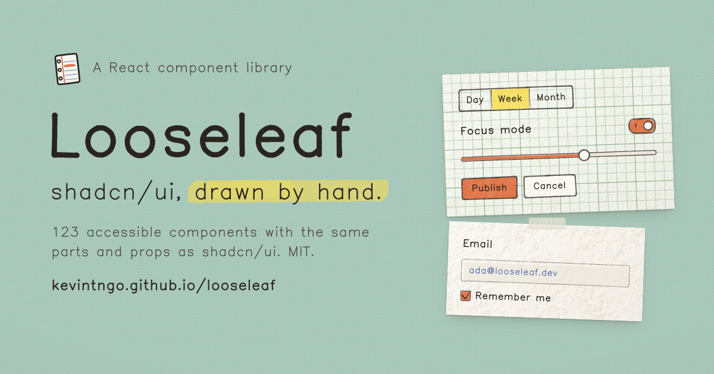

# Looseleaf

**shadcn/ui, drawn by hand.**

[kevintngo.github.io/looseleaf](https://kevintngo.github.io/looseleaf/)



Looseleaf is a React + Tailwind v4 + Radix component library and [shadcn registry](https://ui.shadcn.com/docs/registry) where every surface is paper and every line is drawn with a pen: clean outlines and solid color, with stickers and stamps when you want them. It keeps shadcn/ui's parts, props and `data-slot` names, so you can swap it in without touching your JSX. The charm is decoration; the semantics are ordinary Radix.

| | |
|---|---|
| **123 components** | every shadcn/ui part, from button to sidebar to chart, plus paper objects, marks, stickers, a sketchpad and a chat kit |
| **61 blocks** | sidebars, logins, sign-ups, dashboards, settings, pricing, chat, notes and landing sections |
| **Art** | 160 icons, 48 doodles, 88 stickers, badges and stamps, and Stubby in 15 poses, all drawn in code |
| **Kevin Sans** | one hand-drawn typeface, tuned for three roles: interface text, titles and stamps |
| **Accessible** | keyboard, visible focus, AA text, 24 px targets, reduced motion, forced colors, RTL and three densities |

## Install

Add the registry to `components.json` once:

```json
{
  "registries": { "@looseleaf": "https://kevintngo.github.io/looseleaf/r/{name}.json" }
}
```

Then add what you need:

```sh
npx shadcn@latest add @looseleaf/button
npx shadcn@latest add @looseleaf/login-01
npx shadcn@latest add @looseleaf/looseleaf
```

The theme brings Kevin Sans with it. To load the font by hand instead:

```css
@import url("https://kevintngo.github.io/looseleaf/fonts/kevin-sans.css");
```

```tsx
import { InkProvider } from "@/lib/ink/react"
import { Button } from "@/components/ui/button"

export function App() {
  return (
    <InkProvider>
      <Button>Save changes</Button>
    </InkProvider>
  )
}
```

Components land in your repo as source (`components/ui/*.tsx`, `lib/ink/*`): your code, not a dependency.

## Develop

```sh
npm install
npm run dev              # the documentation site
npm run build            # static site in dist/
npm test                 # vitest
npm run registry:build   # registry.json and public/r/*.json
```

Run `npm run registry:build` after changing a component, so the registry serves the new source. Pushing to `main` deploys the site to GitHub Pages.

## How it works

Everything that is drawn is one `<svg data-ink>` behind the real DOM label. The drawing is a pure, seeded TypeScript function (`src/lib/ink/recipes/<component>-ink.ts`) that writes SVG colored by CSS variables, so the same seed draws the same line on the server and in the browser. States are CSS, not React: hover, press and focus reveal layers that were drawn ahead of time. Every color, pen width and density is a token (`--ll-*`), aliased onto shadcn's semantic variables.

## License

MIT, for the code, the art and Kevin Sans. IBM Plex Mono is SIL OFL 1.1.
